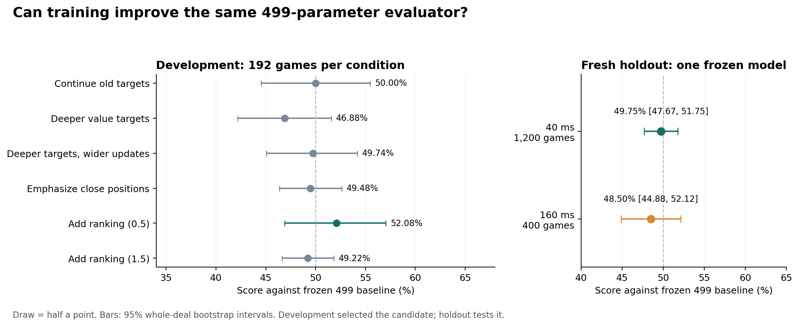

# Improving the 499-parameter evaluator

This experiment does not establish an improvement over the frozen 499-parameter baseline; retain the baseline.

The experiment completed **18 fits, 1,152 development games and 1,600 games on fresh holdout deals**. Every fit retains 499 trainable parameters (529 stored coefficients, 4,252 bytes). The baseline is [`data4x-capacity500-89.cxe`](../scaling-joint/data4x-capacity500-89.cxe), chosen by the lowest existing common validation loss among the three 499-parameter fits. All new fits start from its exact weights.



## Independent confirmation

The frozen candidate is [`deep-rank-half-89.cxe`](deep-rank-half-89.cxe), selected by the [predeclared rule](experiment-plan.json).

| Budget | Games | Wins / draws / losses | Score | Paired 95% interval | Raw win rate |
| --- | ---: | --- | ---: | --- | ---: |
| 40 ms | 1200 | 427 / 340 / 433 | 49.75% | 47.67–51.75% | 35.58% |
| 160 ms | 400 | 139 / 110 / 151 | 48.50% | 44.88–52.12% | 34.75% |

Score is `(wins + draws / 2) / games`. Each hidden deal is played with both seating orders. The interval resamples complete deals 20,000 times. The primary test uses 600 fresh deals; the secondary uses another 200. Both fixed counts were declared before training and completed without optional stopping. The 160 ms interval is a pointwise secondary result.

## Development sweep

These comparisons select a candidate and are exploratory. Each condition aggregates three optimization seeds, with 64 games per seed; conditions share the same 96 deals and seating orders. Intervals resample deals within each fixed optimization-seed block.

| Training variant | Mean common validation loss | Development score | Paired 95% interval |
| --- | ---: | ---: | --- |
| Continue old targets | 0.51733706 | 50.00% | 44.53–55.47% |
| Deeper value targets | 0.51712694 | 46.88% | 42.19–51.56% |
| Deeper targets, wider updates | 0.51684375 | 49.74% | 45.05–54.17% |
| Emphasize close positions | 0.51775631 | 49.48% | 46.35–52.60% |
| Add ranking (0.5) | 0.51756617 | 52.08% | 46.88–57.03% |
| Add ranking (1.5) | 0.51775631 | 49.22% | 46.61–51.82% |

The close-position objective and ranking weight 1.5 selected epoch zero for all three seeds. Their exported weights are byte-identical to the baseline; their development scores reflect match variability, not learned changes.

The selected fit's common validation loss changed from 0.51775631 to 0.51755264; its validation preference agreement changed from 69.06% to 69.99% (ties count as half). These are teacher-fitting diagnostics, not playing-strength evidence.

## Training and controls

The same 9,269 training roots and 1,104 validation roots used by the baseline were reconstructed from saved public states. The deeper teacher is the frozen baseline itself, searched for up to 2,097,152 nodes per root, with a cold transposition table and reset history. It produced **9,153 valid training roots and 1,100 valid validation roots**, plus 15,679 training preference pairs and 1,891 validation pairs. Invalid labels are retained in the raw records but masked identically in every training condition. No validation pair is used for optimization.

All six variants run 80 epochs for each of seeds 53, 71 and 89, with Adam at 0.01 and root batches of 256. They compare continued fitting to old targets, deeper scalar targets, fourfold update bounds with weaker regularization, emphasizing close positions, and two ranking-loss weights. Ranking fits sample 128 training pairs per root batch. Checkpoint selection always minimizes the same new-teacher validation BCE at temperature 600; the original weights at epoch zero remain eligible. Integer evaluator operations use an explicit straight-through surrogate during backpropagation; search and discrete rule features are not differentiated.

Teacher labeling fixes the flip threshold at 5 and disables tablebases. Matches use the unchanged engine's production defaults: both players get the same wall-clock budget and tablebases; the flip threshold is 5 at 40 ms and 6 at 160 ms. Thus the secondary budget tests deployment behavior, rather than isolating a fixed-algorithm test-time scaling slope. Wall-clock matches can vary with scheduling; node-limited label generation is scheduling-independent. This is one training-generation experiment and cannot establish a capacity ceiling.

Old scalar targets came from the residual-network teacher at 160 ms. New targets use the frozen 499 evaluator under a larger fixed node budget. Teacher identity and compute change together, so this experiment compares training recipes and does not isolate a causal effect of search depth alone.

## Checks and reproduction

The labeler reconstructs each public state and asserts exact feature and original-evaluator agreement. Its 18-root smoke test produces identical non-timing labels and preference records with one and two threads. Objective derivatives, child-side preference signs, the combined smooth computation graph, selection rules and seed-block resampling pass six focused checks. Every exported candidate matches native Rust predictions exactly on all 4,845 original validation states. Source, model, dataset and game-result hashes are frozen and verified at stage boundaries.

Run from the repository root. Existing completed artifacts are verified before reuse; unregistered or partial outputs fail explicitly.

Training was run with Python 3.14.7 and NumPy 2.4.6, recorded in the training freeze. Plot rendering also requires Matplotlib; this report was rendered with Matplotlib 3.10.7 in the available Python 3.11.1 environment.

```sh
cargo build --release --offline --manifest-path training/improve499/labeler/Cargo.toml
python3 training/improve499/prepare.py
OPENBLAS_NUM_THREADS=1 VECLIB_MAXIMUM_THREADS=1 python3 training/improve499/run_fits.py
python3 training/improve499/diagnose.py
python3 training/improve499/test_evaluation.py
python3 training/improve499/evaluate.py
PYENV_VERSION=3.11.1 MPLCONFIGDIR=/tmp/cdc-improve499-mpl python training/improve499/report.py
```

The root input format is the existing `CDCSCL01` public-state corpus. New `CDCFT001` records are 32 bytes: row id (u32), root-side score (i32), completed depth (u16), best move (u16), nodes (u64), elapsed milliseconds (f64) and validity flag (u32), all little-endian. Preferences use the existing `CDCRNK01` format. Raw binary corpora and build artifacts are ignored; all model files, manifests, metadata and match CSVs are retained. Regenerating the original wall-clock source corpus is not bit-reproducible; exact reruns require its recorded bytes.

See [the plan](experiment-plan.json), [labeling freeze](labeling-freeze.json), [training freeze](training-freeze.json), [development freeze](development-freeze.json), [selection](selection.json), [full results](results.json), [native parity](native-parity.json) and [verification](verification.json).
