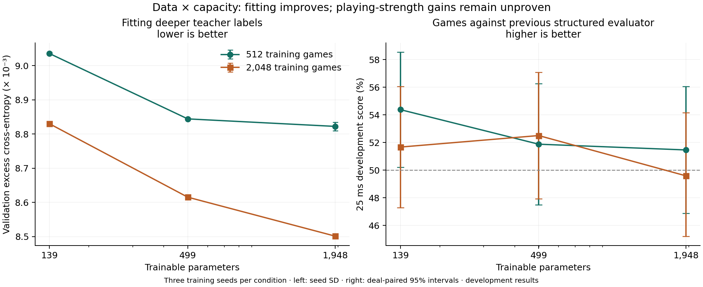

# Data and capacity together

This supplement completes the 2 × 3 data/capacity grid. Its separate protocol was saved after the original seven-condition development sweep and while that sweep’s frozen holdout was running. The original holdout results do not determine advancement. All six supplemental fits and 720 development games are retained.

| Training games | 139 parameters | 499 parameters | 1,948 parameters |
| ---: | --- | --- | --- |
| 512 | 54.37% [50.21%, 58.54%] | 51.88% [47.50%, 56.25%] | 51.46% [46.88%, 56.04%] |
| 2,048 | 51.67% [47.29%, 56.04%] | 52.50% [47.92%, 57.08%] | 49.58% [45.21%, 54.17%] |

Cells are 25 ms development scores and deal-paired 95% intervals against the preceding structured evaluator. Each cell combines three training seeds on the same disjoint deal blocks; it is not one model’s held-out strength. The two new conditions scored 52.50% and 49.58%, below the original control family’s 54.375%. The predeclared advancement rule was not met, so no supplemental final matches were started.

| Additional condition | 8,192-node score [95% interval] | Mean validation loss | Native eval ns |
| --- | --- | ---: | ---: |
| data4x-capacity500 | 54.58% [47.92%, 61.25%] | 0.5175937 | 862 |
| data4x-capacity2000 | 52.50% [46.67%, 58.75%] | 0.5174797 | 891 |

The largest-data/largest-capacity condition reduces excess validation cross entropy by 11.73% relative to the shared initial evaluator. Excess cross entropy subtracts the fixed teacher-target entropy; it is not an improvement in win rate. Its matched 25 ms score contrast against the 2,048-game, 139-parameter control still includes zero.



The curves cover only two data sizes and three composition-table capacities. They support improved fitting, not a playing-strength scaling law. Node-budget intervals are also inconclusive. Eighty epochs and the normalized mean-weight prior are held fixed; larger datasets therefore receive more optimizer steps, and capacity changes alter the prior’s per-coefficient normalization. These experiments do not isolate every optimization effect. The expansion adds composition interactions, not learned spatial features.

All models start from the same previous structured evaluator. Data, labels, game splits, initial coefficients, optimizer settings and seed blocks are shared with the corresponding original conditions. Timing measurements are local single-process microbenchmarks, taken separately after each queue stopped; small timing differences should not be treated as statistically established speedups.

Across both stages: **9 conditions, 27 fits, 3,240 development games and 2,800 final games**. No Colab runtime was allocated. The sum of the individual fitting-job durations is 179.7 seconds; jobs ran concurrently. Search labeling and games dominate the workload.

Evidence: [supplement protocol](experiment-plan.json), [sources and data hashes](run.json), [all results](result.json), [cross-language checks](verification.json), [main held-out report](../scaling/README.md), and [combined machine-readable summary](../scaling-overview.json).

Reproduce the supplement from the repository root, with the retained corpora and completed main sweep:

```sh
python3 training/scaling-joint/run.py
python3 training/scaling_summary.py
MPLCONFIGDIR=/tmp/cdc-scaling-mpl PYENV_VERSION=3.11.1 python training/plot_scaling.py
```

The conditional final-test seed range was unused and remains available only under a newly specified protocol. No model has been promoted over `training/ranking/value.cse`; default engine behavior is unchanged.
