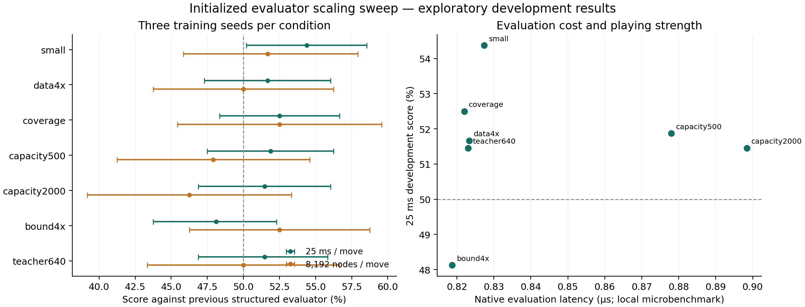

# Scaling the initialized evaluator

The sweep specified before formal training finished: 7 conditions × 3 training seeds, 2,520 development games and 2,800 fresh final games. The frozen candidate is `training/scaling/small-53.cxe`.

The data-collection protocol was saved before collection. Common validation targets and the feasible-capacity layout were clarified before formal training; excluded smoke fits checked correctness and runtime. The separate [data/capacity supplement](../scaling-joint/README.md) completes the grid without changing this frozen candidate.

## Final comparisons

The primary comparison is against the previous structured evaluator at 25 ms/move. All game counts were fixed in advance; each deal is played from both seats. Intervals bootstrap complete deals 20,000 times. The other comparisons are secondary, with pointwise intervals rather than a familywise superiority claim.

| Opponent / time | W / D / L | Score [95% interval] | Elo estimate |
| --- | ---: | --- | ---: |
| original | 320 / 217 / 263 | 53.56% [51.19%, 55.94%] | +24.8 |
| current | 273 / 252 / 275 | 49.88% [47.38%, 52.31%] | -0.9 |
| residual | 291 / 212 / 297 | 49.62% [47.12%, 52.25%] | -2.6 |
| current-100ms | 151 / 107 / 142 | 51.12% [47.88%, 54.37%] | +7.8 |

The primary interval does not establish superiority over the previous structured evaluator. This is not an equivalence or noninferiority test.

## Controlled sweep

Each row aggregates three separately trained models. Their disjoint deal blocks are shared across conditions. The development results select a condition; within it, the final training seed is selected only by common validation loss. Development intervals and matched contrasts are exploratory.

| Condition | Train positions | Trainable coefficients | Validation loss, mean ± SD | 25 ms score [95% interval] | 8,192-node score [95% interval] | Eval ns |
| --- | ---: | ---: | ---: | --- | --- | ---: |
| small | 2,262 | 139 | 0.518014 ± 0.000004 | 54.37% [50.21%, 58.54%] | 51.67% [45.83%, 57.92%] | 827 |
| data4x | 9,269 | 139 | 0.517809 ± 0.000005 | 51.67% [47.29%, 56.04%] | 50.00% [43.75%, 56.25%] | 823 |
| coverage | 2,262 | 139 | 0.517870 ± 0.000005 | 52.50% [48.33%, 56.67%] | 52.50% [45.42%, 59.58%] | 822 |
| capacity500 | 2,262 | 499 | 0.517823 ± 0.000002 | 51.88% [47.50%, 56.25%] | 47.92% [41.25%, 54.58%] | 878 |
| capacity2000 | 2,262 | 1,948 | 0.517801 ± 0.000012 | 51.46% [46.88%, 56.04%] | 46.25% [39.17%, 53.33%] | 898 |
| bound4x | 2,262 | 139 | 0.517869 ± 0.000004 | 48.12% [43.75%, 52.29%] | 52.50% [46.25%, 58.75%] | 819 |
| teacher640 | 2,262 | 139 | 0.517818 ± 0.000011 | 51.46% [46.88%, 55.83%] | 50.00% [43.33%, 56.67%] | 823 |

All development opponents use the previous structured model. The node budget replaces wall-clock stopping; the flip-depth threshold is fixed to five. It is a maximum number of counted negamax/quiescence entries, not an assertion that different evaluators visit identical trees. Raw CSVs retain nodes, completed depth, thinking time and outcomes.



## Data and controls

The actor played 2,048 training games and 256 separate validation games. Collection retained 38,974 training roots and 4,845 validation roots. A label-independent reservoir samples at most 24 roots per completed game, every sixth ply. The stored state contains public cells, visible pool counts and public repetition history; no secret layout is exported or used by the teacher.

- `small`: first 512 training games, quiet roots, 160 ms teacher, 139 trainable coefficients, update bound 1.
- `data4x`: the same rows plus quiet roots from the other 1,536 training games.
- `coverage`: the same number of roots as `small`, sampled without replacement across three hidden-piece phases as evenly as available; tactical roots and roots with a searched flip are eligible.
- `capacity500` and `capacity2000`: identical roots and objective, with 499 or 1,948 trainable coefficients.
- `bound4x`: identical roots and model, with the normalized update bound increased from 1 to 4.
- `teacher640`: exactly the same roots as `small`, labeled at 640 rather than 160 ms. Both budgets start with cold transposition tables and otherwise identical configuration. More time is not itself a measured teacher Elo gain.

Every fit starts from the previous `ranking/value.cse`. The initial checkpoint remains eligible. All conditions use the same 640 ms quiet validation targets; whole-distribution 160 ms phase metrics are reported separately and do not select checkpoints. Training uses scalar sigmoid cross entropy, output-drift regularization and bounded Adam updates. Integer forward rounding is exact; backward rounding uses an explicit straight-through surrogate. Neither rules nor search are differentiated.

This round uses root-value labels, whereas the preceding round used quiet successor pairs. Comparisons within this sweep isolate the declared axes; differences between rounds cannot be attributed solely to architecture. The coverage intervention changes both phase balance and eligibility, so it does not isolate the effect of either alone.

## Capacity and deployment cost

The medium model adds piece-value corrections conditioned on eight hidden-count phases and the feasible number of opposing predators. The large model additionally conditions revealed/hidden piece counts on opposing piece types and counts across five phases. Impossible predator counts and the fully-revealed/hidden-piece group have no coefficients. These are composition features; the expansion does not learn new board geometry. The report includes how many extra columns were actually nonzero in the training corpus.

All added coefficients initialize to zero. Native inference uses fixed-point integer table lookups and sums, with exact export parity. Serialized files include 30 preserved, inactive base coefficients, so file parameter counts exceed trainable counts. File size excludes prepared base tables and the rest of the engine. Evaluation timings use the same 1,881 public positions, seven runs of 100 passes, after collection, fitting and matches have stopped; they are not whole-search speedups.

## Compute, evidence and reproduction

No Colab GPU was allocated. The original 5,367-pair fitting pilot took 0.62 seconds for two epochs; an expanded-model smoke fit also completed two epochs in under one second. Four local NumPy fits run concurrently, and native labeling/matches use at most twelve CPU workers. No GPU speedup or GPU cost is claimed.

See [protocol](experiment-plan.json), [collection provenance](run.json), [training manifest](training-manifest.json), [all fits](training-results.json), [development results](development-results.json), [frozen candidate](frozen-candidate.json), [final results](result.json), [native parity checks](verification-full.json), and [machine-readable summary](summary.json). Collection depends on wall-clock scheduling; training from the retained hashed corpus is reproducible.

From the repository root, after building the Rust binaries and collecting the documented corpora:

```sh
OPENBLAS_NUM_THREADS=1 OMP_NUM_THREADS=1 VECLIB_MAXIMUM_THREADS=1 python3 training/scaling/run.py fit
python3 training/scaling/run.py development
python3 training/scaling/run.py holdout
python3 training/scaling/report.py
```

Completed jobs are reused only when their recorded configurations and hashes match. Existing final deals have been used and must not serve as fresh holdouts for future model selection. The engine default is unchanged. These few scale points do not establish a power law or an unlimited scaling advantage.
