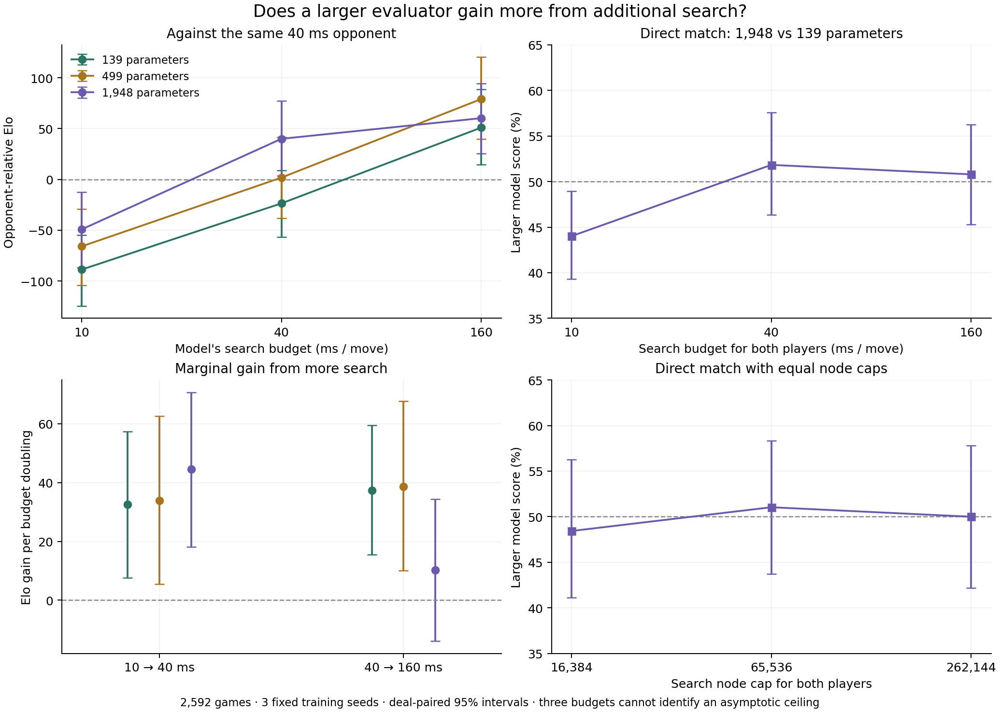

# Evaluator capacity × test-time search

These games do not establish that the larger evaluator benefits more from additional search.

The preregistered primary contrast, large-versus-small score at 160 ms minus its score at 10 ms, is **+6.8 [-1.0, +14.6] percentage points** (95% paired interval). This measures a finite-budget interaction, not an asymptotic ceiling.

Against the fixed opponent, the 139-parameter model gains +139.8 [+91.0, +190.1] Elo and the 1,948-parameter model gains +109.5 [+59.9, +160.3]. Their difference is -30.3 [-96.4, +35.7] Elo. The direct and anchored interaction point estimates should be read together with their uncertainty; disagreement between point estimates can reflect sampling variation or opponent-dependent effects.

All 2,592 games and 45 batches completed with verified input/output hashes. Every capacity uses the same 9,269 training positions and three fixed training seeds (53, 71, 89); each receives equal weight. The nine existing models are frozen. No new model is promoted from this experiment.

## Capacity and wall-clock curves

The opponent is always the previous structured evaluator at 40 ms per move. Holding this opponent fixed exposes gains that would disappear if both players received more search time. Each cell contains 192 games: 96 deals with seats reversed, split equally among the three training seeds.

| Trainable parameters | 10 ms score | 40 ms score | 160 ms score | 10→160 ms Elo gain |
|---:|---:|---:|---:|---:|
| 139 | 37.50% [32.81, 42.19] | 46.61% [41.93, 51.30] | 57.29% [52.08, 62.50] | +139.8 [+91.0, +190.1] |
| 499 | 40.62% [35.42, 45.83] | 50.26% [44.53, 55.99] | 61.20% [55.73, 66.67] | +145.1 [+93.1, +197.7] |
| 1948 | 42.97% [37.76, 48.18] | 55.73% [50.52, 60.94] | 58.59% [53.65, 63.28] | +109.5 [+59.9, +160.3] |

Elo is a descriptive conversion from score against this particular fixed opponent: `400 log10(score / (1 − score))`. It is not an independently calibrated universal rating. Draws count as half a point.

| Parameters | Elo gain per doubling, 10→40 ms | Elo gain per doubling, 40→160 ms |
|---:|---:|---:|
| 139 | +32.6 [+7.6, +57.4] | +37.3 [+15.5, +59.4] |
| 499 | +33.9 [+5.5, +62.6] | +38.7 [+10.1, +67.7] |
| 1948 | +44.6 [+18.1, +70.7] | +10.2 [-13.9, +34.3] |

The difference in anchored 10→160 ms Elo gain between 1,948 and 139 parameters is -30.3 [-96.4, +35.7]. This secondary contrast preserves the common deals across capacities and budgets.

## Equal-budget direct matches

The 1,948-parameter model plays the 139-parameter model with the same training seed. These direct matches use different deals from the fixed-anchor matches. A score above 50% favors the larger model.

| Budget per player | Games | Large model score, 95% interval | Relative Elo, 95% interval |
|---:|---:|---:|---:|
| 10 ms | 192 | 44.01% [39.32, 48.96] | -41.8 [-75.4, -7.2] |
| 40 ms | 192 | 51.82% [46.35, 57.55] | +12.7 [-25.4, +52.9] |
| 160 ms | 192 | 50.78% [45.31, 56.25] | +5.4 [-32.7, +43.7] |

A crossover meeting the declared pointwise-interval criterion: **no**. Point estimates crossing 50% alone do not establish a crossover; this secondary comparison has no familywise multiplicity correction.

| Node cap per player | Games | Large model score, 95% interval | Actual ms/move, large / small |
|---:|---:|---:|---:|
| 16,384 | 96 | 48.44% [41.15, 56.25] | 5.18 / 4.72 |
| 65,536 | 96 | 51.04% [43.75, 58.33] | 19.27 / 17.66 |
| 262,144 | 96 | 50.00% [42.19, 57.81] | 81.67 / 74.56 |

The low-to-high node-budget score change is +1.6 [-9.4, +12.5] percentage points. A node is a search visit; equal node caps do not guarantee identical trees, evaluation counts, or FLOPs.

## Search and timing controls

The search code and models are unchanged. Both sides explicitly use `fmd=5,tb=0,depth=64,idstop=0.65`, with an 18-bit transposition table. Fixing the flip-search threshold avoids the production default's change at 80 ms. Tablebases are disabled to isolate learned evaluation and search. Six randomized batches run concurrently with two CPU workers each; wall-clock stopping is sensitive to system scheduling. Fixed-node runs override time stopping and have an asserted per-move cap.

This controlled configuration differs from production defaults. In particular, positions with five or fewer pieces were excluded from the training corpus; disabling tablebases exposes learned evaluation to those endgames. The curves therefore describe this fixed search configuration and should be followed by a separate production-setting confirmation before deployment. Nodes and depth are averages over different played trajectories, not a same-position inference microbenchmark.

| Parameters | Budget ms | Actual ms/move | Nodes/move | Completed depth |
|---:|---:|---:|---:|---:|
| 139 | 10 | 8.65 | 31322 | 7.08 |
| 139 | 40 | 34.94 | 138766 | 8.59 |
| 139 | 160 | 136.77 | 530864 | 9.46 |
| 499 | 10 | 8.61 | 31408 | 7.07 |
| 499 | 40 | 34.70 | 127363 | 8.32 |
| 499 | 160 | 138.23 | 580437 | 9.89 |
| 1948 | 10 | 8.60 | 29307 | 6.68 |
| 1948 | 40 | 34.99 | 126334 | 8.51 |
| 1948 | 160 | 138.22 | 474151 | 9.56 |

## Interpretation and limits

A larger evaluator can reduce leaf-evaluation error and improve move ordering, so deeper search may amplify its advantage. Search can also compensate for a smaller evaluator's weaknesses, or amplify systematic evaluation errors; neither curve ordering nor monotonic gains are guaranteed. The relevant empirical object is strength as a joint function of capacity, training data/compute, search budget, and the search algorithm.

For the fixed opponent, the capacity–time interaction is `[E_large(160) − E_large(10)] − [E_small(160) − E_small(10)]`. Positive values mean the larger model gains more over this interval; a higher score at every time budget by itself does not establish that interaction. The direct-match primary contrast supplies a separate comparison that avoids relying on transitivity of ratings against the anchor.

There are also two different optimization questions: measuring capacity effects with a fixed search algorithm, as here, and finding the best achievable strength at each total compute budget after tuning search settings. The latter needs a separate validation procedure for each capacity/budget combination. A plateau under a fixed selective search can be caused by excluded branches or its depth limit, not only model expressivity.

Training and test-time compute tradeoffs have been measured in AlphaZero/Hex, including architecture-dependent search curves, but that does not establish the same law for this engine ([Jones, 2021, Figures 8–9](https://arxiv.org/abs/2104.03113)). Stockfish also emphasizes that evaluation accuracy must be balanced against search throughput ([NNUE documentation](https://official-stockfish.github.io/docs/nnue-pytorch-wiki/docs/nnue.html)).

Three budgets span 16x compute and permit two local slopes, but cannot identify an asymptotic ceiling or establish a scaling law. This is one sparse composition expansion family and one fixed training dataset. Capacity also changes the per-coefficient strength of the existing mean-normalized regularizer; the study concerns these trained models, not parameter count in isolation. Selective alpha-beta/chance search need not improve monotonically with budget. Fully exact exhaustive solving, if feasible, would remove reliance on the evaluator; this implementation's selective search is not an exhaustive solver.

The frozen model diagnostics on 4,845 existing validation roots show mean absolute score differences of 15.36 and 20.32 engine units for the 499- and 1,948-parameter models relative to their same-seed 139-parameter counterparts. The additional tables are active, but this is still a modest expansion around the same learned evaluator. These static-score diagnostics are descriptive and do not select models or supply independent evidence of playing strength; exact values are in [model-diagnostics.json](model-diagnostics.json).

Intervals use 20,000 bootstrap replicates of entire two-game deals, stratified within each fixed training seed and matched across budgets/capacities. They quantify deal uncertainty conditional on these nine trained models, not variation across all possible training runs. Only the declared direct-match endpoint is primary; all other intervals are exploratory and pointwise. None of the tests reuse training or validation deals. No outcome-dependent stopping or model selection was used.

The endgame solver limit, if exact exhaustive solving were feasible, would be shared by models using the same rules. The finite-budget plateau of this selective search is a separate empirical question. Three time points cannot identify it. The next expansion should be a fresh, declared wider-budget study with sufficient games, followed by stronger training targets or search-aligned objectives if capacity gains remain absent.

## Reproduction

```sh
python3 training/test-time/run.py --verify-only
python3 training/test-time/run.py
python3 training/test-time/diagnostics.py
python3 training/test-time/analyze.py
MPLCONFIGDIR=/tmp/cdc-scaling-mpl PYENV_VERSION=3.11.1 python training/test-time/plot.py
```

The queue rejects changed frozen inputs and validates completed CSV hashes before resuming. [The protocol](experiment-plan.json), [frozen manifest](run.json), [machine-readable results](results.json), per-batch CSVs, and per-batch run records are included. NumPy is needed for analysis and Matplotlib for the standalone figures. The arena binary is the same verified binary used in the preceding experiment. No GPU was allocated: these matches use the existing native CPU search.


