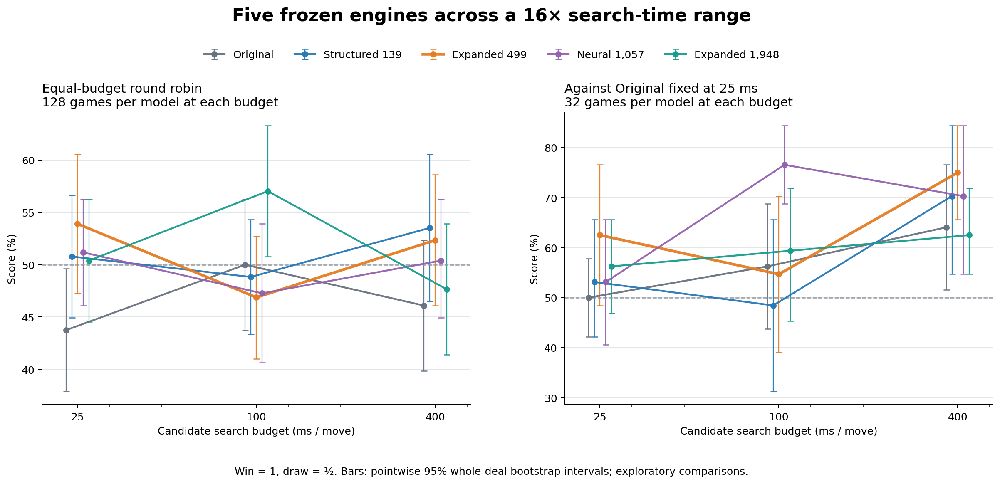
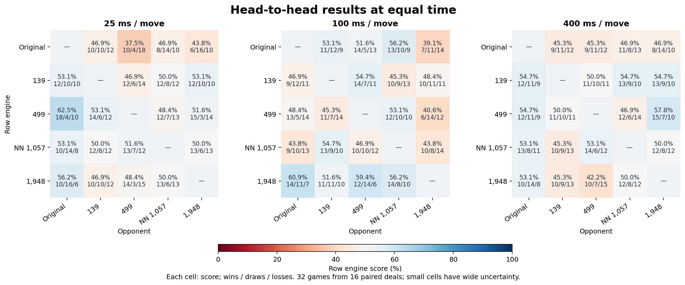
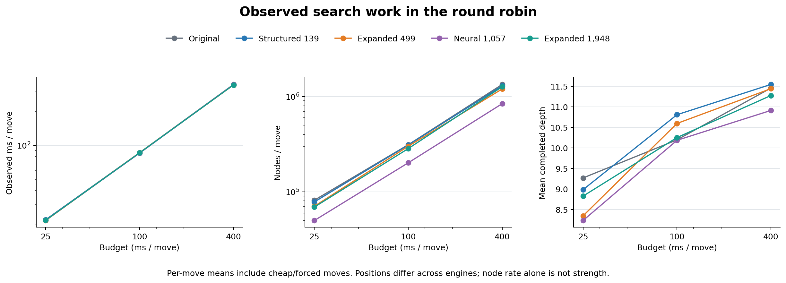

# 五個引擎版本的時間預算比較

完成 **1,312 局、41 組對戰**。五個版本使用凍結權重，在每步 25、100、400 ms 互相對戰，並另與固定 25 ms 的原版比較。所有事先設定的對戰均完成，沒有依結果提早停止或更換模型。

**三個時間點的循環賽點估計第一名分別為：25 ms 的 499 版、100 ms 的 1,948 版、400 ms 的 139 版。這輪沒有確認一個全面最強的版本，也沒有看到較大模型一致獲得較大的搜尋收益。** 400 ms 下，139 與 499 直接互打為 11 勝／10 和／11 負，得分率 50%；因此保留 499 作為研究基準，不把這次探索排序當成替換依據。

這是小型探索比較：每個直接對戰條件只有 16 副獨立牌局（交換先後手，共 32 局）。表中得分率為 `(勝 + 和 / 2) / 局數`，不是純勝率；方括號為配對 bootstrap 的 95% 區間。點估計第一名不等於已確認的最強版本。



## 同時間循環賽

每個版本在每個時間點對其餘四個版本各下 32 局，共 128 局。平均得分對四個對手等權。

| 版本 | 25 ms | 100 ms | 400 ms |
| --- | ---: | ---: | ---: |
| Original | 43.8% [37.9, 49.6] | 50.0% [43.8, 56.2] | 46.1% [39.8, 52.3] |
| Structured 139 | 50.8% [44.9, 56.6] | 48.8% [43.4, 54.3] | 53.5% [46.5, 60.5] |
| Expanded 499 | 53.9% [47.3, 60.5] | 46.9% [41.0, 52.7] | 52.3% [46.1, 58.6] |
| Neural 1,057 | 51.2% [46.1, 56.2] | 47.3% [40.6, 53.9] | 50.4% [44.9, 56.2] |
| Expanded 1,948 | 50.4% [44.5, 56.2] | 57.0% [50.8, 63.3] | 47.7% [41.4, 53.9] |

各時間的點估計排序（同分不代表可分出高下）：

- **25 ms：** Expanded 499 53.9% → Neural 1,057 51.2% → Structured 139 50.8% → Expanded 1,948 50.4% → Original 43.8%
- **100 ms：** Expanded 1,948 57.0% → Original 50.0% → Structured 139 48.8% → Neural 1,057 47.3% → Expanded 499 46.9%
- **400 ms：** Structured 139 53.5% → Expanded 499 52.3% → Neural 1,057 50.4% → Expanded 1,948 47.7% → Original 46.1%

所有版本都增加時間時，循環賽分數的平均必然維持 50%。下表量的是相對排名的變化；不能把某版本得分下降直接解讀為它多想之後變弱。

| 版本 | 25 → 100 ms | 100 → 400 ms | 25 → 400 ms |
| --- | ---: | ---: | ---: |
| Original | +6.2 [-2.7, +14.8] | -3.9 [-12.1, +4.3] | +2.3 [-6.6, +11.3] |
| Structured 139 | -2.0 [-9.8, +5.9] | +4.7 [-4.7, +14.1] | +2.7 [-7.4, +12.5] |
| Expanded 499 | -7.0 [-16.8, +2.7] | +5.5 [-3.1, +13.7] | -1.6 [-10.5, +7.4] |
| Neural 1,057 | -3.9 [-10.5, +3.1] | +3.1 [-4.7, +10.9] | -0.8 [-8.6, +7.0] |
| Expanded 1,948 | +6.6 [-1.6, +15.2] | -9.4 [-17.6, -0.8] | -2.7 [-11.3, +5.9] |

單位：得分率百分點，附配對 95% 區間。

## 固定對手下的搜尋收益

對手一律是每步 25 ms 的原版，只有我方增加時間。每個版本的三個時間點沿用同一組牌局；不同版本使用不同的牌局組。原版對原版也實際下了對照局，沒有把其 25 ms 得分硬設成 50%。

| 我方版本 | 25 ms | 100 ms | 400 ms | 25 → 400 ms 增益（百分點） |
| --- | ---: | ---: | ---: | ---: |
| Original | 50.0% [42.2, 57.8] | 56.2% [43.8, 68.8] | 64.1% [51.6, 76.6] | +14.1 [-1.6, +29.7] |
| Structured 139 | 53.1% [42.2, 65.6] | 48.4% [31.2, 65.6] | 70.3% [54.7, 84.4] | +17.2 [+1.6, +32.8] |
| Expanded 499 | 62.5% [48.4, 76.6] | 54.7% [39.1, 70.3] | 75.0% [65.6, 84.4] | +12.5 [-4.7, +31.2] |
| Neural 1,057 | 53.1% [40.6, 65.6] | 76.6% [68.8, 84.4] | 70.3% [54.7, 84.4] | +17.2 [-4.7, +39.1] |
| Expanded 1,948 | 56.2% [46.9, 65.6] | 59.4% [45.3, 71.9] | 62.5% [54.7, 71.9] | +6.2 [-3.1, +17.2] |

固定對手下各時間區間的增益（得分率百分點；同組牌局配對比較）：

| 我方版本 | 25 → 100 ms | 100 → 400 ms | 25 → 400 ms |
| --- | ---: | ---: | ---: |
| Original | +6.2 [-7.8, +20.3] | +7.8 [-9.4, +26.6] | +14.1 [-1.6, +29.7] |
| Structured 139 | -4.7 [-31.2, +20.3] | +21.9 [-1.6, +43.8] | +17.2 [+1.6, +32.8] |
| Expanded 499 | -7.8 [-31.2, +17.2] | +20.3 [+4.7, +35.9] | +12.5 [-4.7, +31.2] |
| Neural 1,057 | +23.4 [+7.8, +39.1] | -6.2 [-23.4, +10.9] | +17.2 [-4.7, +39.1] |
| Expanded 1,948 | +3.1 [-10.9, +17.2] | +3.1 [-9.4, +17.2] | +6.2 [-3.1, +17.2] |

## 如何解讀差異

25 ms 的 499 版與 400 ms 的 139 版，循環賽平均得分率分別為 53.9% [47.3, 60.5] 與 53.5% [46.5, 60.5]。其點估計領先尚未建立對其他版本的明確優勢；400 ms 的 139 與 499 平均得分只差約 1.2 個百分點，直接對戰得分也恰好各半，不能據此宣稱兩者等效或分出最強。

100 ms 的 1,948 版是值得複驗的訊號：循環賽平均得分率比 499 高 10.2 個百分點，逐項 95% 區間為 +0.4～+19.9。但同時間兩版的直接對戰，1,948 得分率為 59.4%，區間 46.9%～71.9%，仍跨過 50%；本輪也未校正多重比較，不能把這個單一訊號當作已確認的優勢。

對固定 25 ms 原版，五版從 25 增至 400 ms 的得分增益點估計皆為正，介於 +6.25～+17.19 個百分點；139 的整段增益逐項區間高於零，其餘四版仍包含零。499 從 100 增至 400 ms 的增益為 +20.3 個百分點 [4.7, 35.9]。神經網路版從 100 至 400 ms 的點估計下降 6.25 個百分點，但區間為 −23.4～+10.9，不能據此判定更多時間有害。這些都是探索結果。

## 直接對戰



以下均從左方版本的角度計算；勝／和／負總數為 32。

| 時間 | 左方 | 右方 | 勝／和／負 | 左方得分率 [95% 區間] |
| ---: | --- | --- | --- | ---: |
| 25 ms | Structured 139 | Original | 12／10／10 | 53.1% [42.2, 65.6] |
| 25 ms | Expanded 499 | Original | 18／4／10 | 62.5% [48.4, 76.6] |
| 25 ms | Neural 1,057 | Original | 10／14／8 | 53.1% [40.6, 65.6] |
| 25 ms | Expanded 1,948 | Original | 10／16／6 | 56.2% [46.9, 65.6] |
| 25 ms | Structured 139 | Expanded 499 | 12／6／14 | 46.9% [32.8, 59.4] |
| 25 ms | Structured 139 | Neural 1,057 | 12／8／12 | 50.0% [42.2, 59.4] |
| 25 ms | Structured 139 | Expanded 1,948 | 12／10／10 | 53.1% [39.1, 67.2] |
| 25 ms | Expanded 499 | Neural 1,057 | 12／7／13 | 48.4% [37.5, 59.4] |
| 25 ms | Expanded 499 | Expanded 1,948 | 15／3／14 | 51.6% [37.5, 67.2] |
| 25 ms | Neural 1,057 | Expanded 1,948 | 13／6／13 | 50.0% [40.6, 57.8] |
| 100 ms | Structured 139 | Original | 9／12／11 | 46.9% [39.1, 54.7] |
| 100 ms | Expanded 499 | Original | 13／5／14 | 48.4% [32.8, 64.1] |
| 100 ms | Neural 1,057 | Original | 9／10／13 | 43.8% [29.7, 57.8] |
| 100 ms | Expanded 1,948 | Original | 14／11／7 | 60.9% [50.0, 71.9] |
| 100 ms | Structured 139 | Expanded 499 | 14／7／11 | 54.7% [50.0, 59.4] |
| 100 ms | Structured 139 | Neural 1,057 | 10／9／13 | 45.3% [31.2, 59.4] |
| 100 ms | Structured 139 | Expanded 1,948 | 10／11／11 | 48.4% [34.4, 62.5] |
| 100 ms | Expanded 499 | Neural 1,057 | 12／10／10 | 53.1% [40.6, 65.6] |
| 100 ms | Expanded 499 | Expanded 1,948 | 6／14／12 | 40.6% [28.1, 53.1] |
| 100 ms | Neural 1,057 | Expanded 1,948 | 10／8／14 | 43.8% [32.8, 56.2] |
| 400 ms | Structured 139 | Original | 12／11／9 | 54.7% [40.6, 68.8] |
| 400 ms | Expanded 499 | Original | 12／11／9 | 54.7% [42.2, 65.6] |
| 400 ms | Neural 1,057 | Original | 13／8／11 | 53.1% [42.2, 64.1] |
| 400 ms | Expanded 1,948 | Original | 10／14／8 | 53.1% [40.6, 65.6] |
| 400 ms | Structured 139 | Expanded 499 | 11／10／11 | 50.0% [35.9, 64.1] |
| 400 ms | Structured 139 | Neural 1,057 | 13／9／10 | 54.7% [42.2, 67.2] |
| 400 ms | Structured 139 | Expanded 1,948 | 13／9／10 | 54.7% [39.1, 70.3] |
| 400 ms | Expanded 499 | Neural 1,057 | 12／6／14 | 46.9% [34.4, 59.4] |
| 400 ms | Expanded 499 | Expanded 1,948 | 15／7／10 | 57.8% [45.3, 70.3] |
| 400 ms | Neural 1,057 | Expanded 1,948 | 12／8／12 | 50.0% [42.2, 59.4] |

## 實際搜尋工作量



搜尋保留現有 arena 的預設直接搜尋模式，未啟用 MoE 抽樣：殘局庫開啟、18-bit 置換表、最大深度 64、迭代加深停止比例 0.65。翻子搜尋門檻依各自預算自動設定：25 ms 為 5，100／400 ms 為 6。這衡量實際時間設定下的引擎行為，不能完全歸因於同一搜尋策略下的純計算量增加，也不是網頁 MoE 多樣模式的測試。

時間包含評估器推論和殘局庫建構。便宜的走法、強制走法與迭代加深停止策略會使平均耗時低於每步預算；下表從循環賽的實際記錄彙總。

| 時間 | 版本 | 勝／和／負 | 純勝率 | 實際 ms／步 | 節點／步 | 平均完成深度 |
| ---: | --- | --- | ---: | ---: | ---: | ---: |
| 25 | Original | 34／44／50 | 26.6% | 22.14 | 81,543 | 9.27 |
| 25 | Structured 139 | 48／34／46 | 37.5% | 22.13 | 78,220 | 8.98 |
| 25 | Expanded 499 | 59／20／49 | 46.1% | 21.82 | 70,414 | 8.35 |
| 25 | Neural 1,057 | 48／35／45 | 37.5% | 21.96 | 49,914 | 8.23 |
| 25 | Expanded 1,948 | 47／35／46 | 36.7% | 21.93 | 69,061 | 8.83 |
| 100 | Original | 45／38／45 | 35.2% | 86.33 | 311,969 | 10.20 |
| 100 | Structured 139 | 43／39／46 | 33.6% | 85.68 | 310,255 | 10.81 |
| 100 | Expanded 499 | 42／36／50 | 32.8% | 86.16 | 300,674 | 10.59 |
| 100 | Neural 1,057 | 42／37／49 | 32.8% | 85.60 | 201,593 | 10.19 |
| 100 | Expanded 1,948 | 51／44／33 | 39.8% | 86.01 | 284,230 | 10.25 |
| 400 | Original | 37／44／47 | 28.9% | 344.36 | 1,339,760 | 11.46 |
| 400 | Structured 139 | 49／39／40 | 38.3% | 342.25 | 1,295,286 | 11.54 |
| 400 | Expanded 499 | 50／34／44 | 39.1% | 340.67 | 1,202,259 | 11.44 |
| 400 | Neural 1,057 | 49／31／48 | 38.3% | 342.95 | 841,808 | 10.91 |
| 400 | Expanded 1,948 | 42／38／48 | 32.8% | 341.23 | 1,267,593 | 11.27 |

## 模型與不確定性

原版是既有手寫形式的評估器；139／499／1,948 參數版是結構化學習評估器，1,057 參數版才是 64 → 16 → 1 ReLU 殘差網路（scale 0.5）。499 與 1,948 的容量擴充使用查表項。五個版本的資料、訓練目標與特徵並非完全一致，因此本輪比較的是實際版本，無法單獨證明增加參數數量的因果效果。

| 版本 | 學習模型的可訓練參數 | 凍結模型 |
| --- | ---: | --- |
| Original | — | 原版（無外部學習模型） |
| Structured 139 | 139 | [value.cse](../../training/ranking/value.cse) |
| Expanded 499 | 499 | [data4x-capacity500-89.cxe](../../training/scaling-joint/data4x-capacity500-89.cxe) |
| Neural 1,057 | 1,057 | [strong-teacher.nn](../../training/strong-teacher.nn) |
| Expanded 1,948 | 1,948 | [data4x-capacity2000-89.cxe](../../training/scaling-joint/data4x-capacity2000-89.cxe) |

1,948 參數版本在本輪開始前，依既有共同驗證損失從 seeds 53／71／89 選出 seed 89；其他版本沿用先前已指定的權重。所有模型 SHA-256、metadata、arena 二進位、引擎原始碼、分析程式與排程在第一局前凍結並於結束後核對。

每組直接對手使用不同的 16 副牌，三個時間點重用該組牌局。循環賽共 160 副牌，原版固定對手的自我對照另用 16 副牌。學習版固定對手系列在 25 ms 重用循環賽結果，其餘 100／400 ms 另打，總計 1,312 局且沒有重複計數。種子範圍與所有模型的訓練／驗證牌局均不重疊。

分析以整副牌的兩局為抽樣單位，進行 20,000 次分層 bootstrap；不同牌局組獨立抽樣，同組跨時間與重用的比賽共享抽樣索引。循環賽中雙方得分互補，保留相依性。所有區間為逐項 95% 區間，未做多重比較校正，且不涵蓋重新訓練種子的變異。三個有限時間點不能證明棋力上限。

## 重現與檢查

執行環境使用 Python 3.11.1、NumPy 1.26.4、Matplotlib 3.10.7。原生 CPU 搜尋以 6 組對戰 × 2 個 workers 並行，未使用 GPU。計時受系統排程影響，重跑比賽不保證逐局結果完全相同；保留原始 CSV 可精確重現分析。

```sh
PYENV_VERSION=3.11.1 python -m unittest discover -s training/tournament -v
PYENV_VERSION=3.11.1 python training/tournament/run.py --verify-only
PYENV_VERSION=3.11.1 python training/tournament/run.py
PYENV_VERSION=3.11.1 python training/tournament/analyze.py
PYENV_VERSION=3.11.1 MPLCONFIGDIR=/tmp/cdc-tournament-mpl python training/tournament/report.py
```

已完成的對戰只在輸入與 CSV 雜湊通過檢查後重用。未登記的輸出、缺少先後手、牌局重複、錯誤局數或權重改變均會明確失敗。五項測試涵蓋完整排程、固定對手重用、對戰方向、循環賽零和相依性及跨時間配對抽樣。

原始證據：[事先固定的計畫](experiment-plan.json)、[凍結記錄](run.json)、[完成記錄與 CSV 雜湊](completion.json)、[完整數值結果](results.json)。
