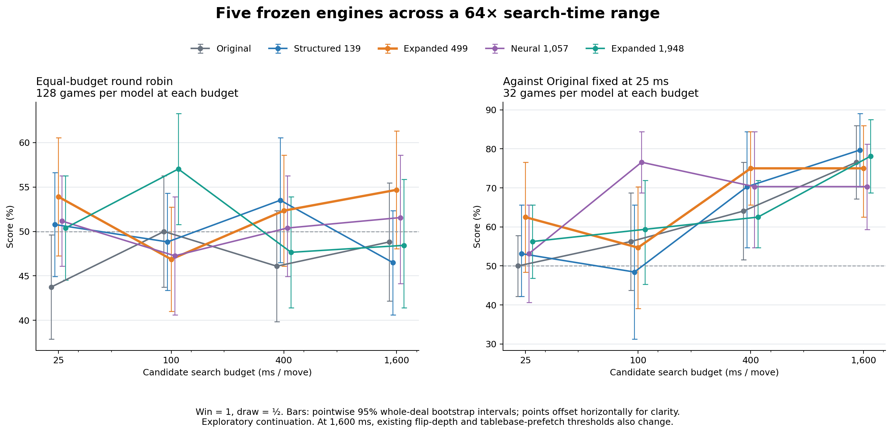
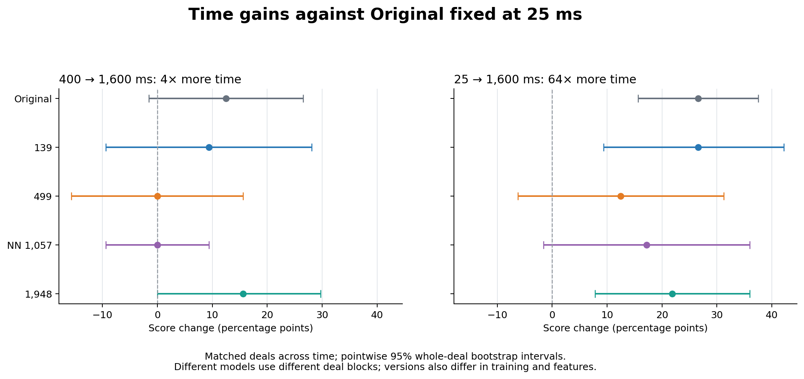
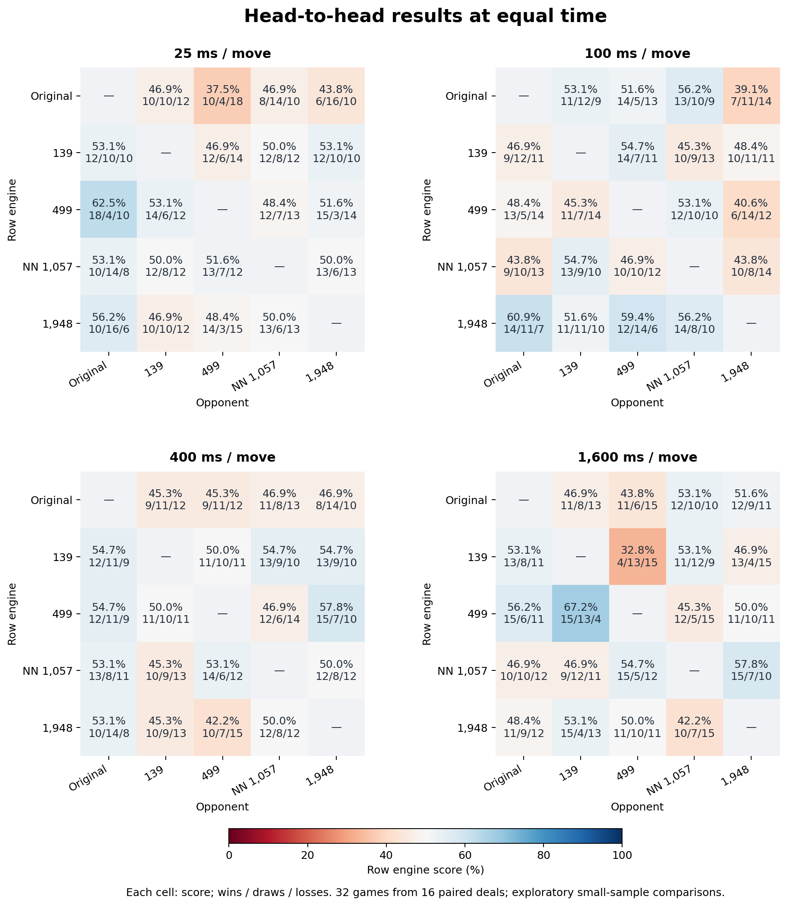
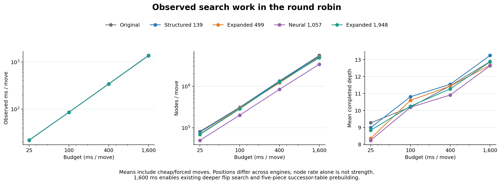

# 每步 1,600 ms 的延伸比較

新增 **480 局**，與原來 1,312 局合併，共 **1,792 局**。五個凍結版本沿用相同牌局與先後手配對，測試時間形成 **25 → 100 → 400 → 1,600 ms**、每級四倍的序列。所有預定對局均完成；以原始資料重新計算的舊有點估計、區間與差值，均與原報告一致。

**1,600 ms 循環賽的點估計最高為 Expanded 499（54.7%），本輪繼續保留 499 作為研究基準。** 尚未確認一個全面最強的版本。每組直接對戰只有 16 副獨立牌局，交換先後手後為 32 局；這是探索性的小型延伸比較。

本文的得分率為 `(勝 + 和 / 2) / 局數`；不是純勝率。方括號為整副牌局配對 bootstrap 的點態 95% 區間；所有差值以百分點表示，未做多重比較校正。

**最值得進一步確認的是 499 對 139 的長時間表現。** 400 ms 時雙方得分各 50%；1,600 ms 時，499 取得 15 勝／13 和／4 負，得分率 67.2% [56.2, 78.1]，配對時間增益為 +17.2 [+1.6, +35.9] 個百分點。這項區間尚未做多重比較校正，而且延伸實驗沿用先前的牌局，需要新牌確認。499 對同樣 1,600 ms 的原版得分率為 56.2% [42.2, 70.3]，仍不能確認其長時間優勢。

**499 的固定對手曲線在這一段沒有增加，但不能據此判定已到上限。** 對手維持原版 25 ms 時，499 在 400 與 1,600 ms 的得分率都是 75.0%；400 → 1,600 ms 的配對增益為 +0.0 [-15.6, +15.6] 個百分點，仍容許可觀的正負差異。所有模型配對在 400 → 1,600 ms、25 → 1,600 ms 兩段的收益差區間都包含零，沒有確認較大容量獲得較大搜尋收益。



## 同時間循環賽

每個版本在每個時間點對其餘四版各下 32 局，共 128 局；四個對手等權。

| 版本 | 25 ms | 100 ms | 400 ms | 1,600 ms |
| --- | ---: | ---: | ---: | ---: |
| Original | 43.8% [37.9, 49.6] | 50.0% [43.8, 56.2] | 46.1% [39.8, 52.3] | 48.8% [42.2, 55.5] |
| Structured 139 | 50.8% [44.9, 56.6] | 48.8% [43.4, 54.3] | 53.5% [46.5, 60.5] | 46.5% [40.6, 52.3] |
| Expanded 499 | 53.9% [47.3, 60.5] | 46.9% [41.0, 52.7] | 52.3% [46.1, 58.6] | 54.7% [48.0, 61.3] |
| Neural 1,057 | 51.2% [46.1, 56.2] | 47.3% [40.6, 53.9] | 50.4% [44.9, 56.2] | 51.6% [44.1, 58.6] |
| Expanded 1,948 | 50.4% [44.5, 56.2] | 57.0% [50.8, 63.3] | 47.7% [41.4, 53.9] | 48.4% [41.4, 55.9] |

雙方一起增加時間時，整個循環賽的平均得分必然維持 50%。下面量的是相對表現的變化；分數下降不能直接解讀為多想之後變弱。

| 版本 | 400 → 1,600 ms | 25 → 1,600 ms |
| --- | ---: | ---: |
| Original | +2.7 [-6.2, +12.1] | +5.1 [-3.5, +14.1] |
| Structured 139 | -7.0 [-16.4, +2.3] | -4.3 [-12.1, +3.9] |
| Expanded 499 | +2.3 [-6.6, +11.3] | +0.8 [-9.0, +10.5] |
| Neural 1,057 | +1.2 [-7.8, +9.8] | +0.4 [-8.2, +9.0] |
| Expanded 1,948 | +0.8 [-9.0, +10.9] | -2.0 [-10.2, +6.6] |

## 固定對手：原版維持 25 ms

只增加候選版本的時間，用來觀察搜尋收益。各模型在不同時間重複相同的 16 副牌；模型之間的牌局區塊不同。

| 版本 | 25 ms | 100 ms | 400 ms | 1,600 ms |
| --- | ---: | ---: | ---: | ---: |
| Original | 50.0% [42.2, 57.8] | 56.2% [43.8, 68.8] | 64.1% [51.6, 76.6] | 76.6% [67.2, 85.9] |
| Structured 139 | 53.1% [42.2, 65.6] | 48.4% [31.2, 65.6] | 70.3% [54.7, 84.4] | 79.7% [70.3, 89.1] |
| Expanded 499 | 62.5% [48.4, 76.6] | 54.7% [39.1, 70.3] | 75.0% [65.6, 84.4] | 75.0% [62.5, 85.9] |
| Neural 1,057 | 53.1% [40.6, 65.6] | 76.6% [68.8, 84.4] | 70.3% [54.7, 84.4] | 70.3% [59.4, 81.2] |
| Expanded 1,948 | 56.2% [46.9, 65.6] | 59.4% [45.3, 71.9] | 62.5% [54.7, 71.9] | 78.1% [68.8, 87.5] |

| 版本 | 400 → 1,600 ms 收益 | 100 → 1,600 ms 收益 | 25 → 1,600 ms 收益 |
| --- | ---: | ---: | ---: |
| Original | +12.5 [-1.6, +26.6] | +20.3 [+6.2, +34.4] | +26.6 [+15.6, +37.5] |
| Structured 139 | +9.4 [-9.4, +28.1] | +31.2 [+10.9, +50.0] | +26.6 [+9.4, +42.2] |
| Expanded 499 | +0.0 [-15.6, +15.6] | +20.3 [+0.0, +40.6] | +12.5 [-6.2, +31.2] |
| Neural 1,057 | +0.0 [-9.4, +9.4] | -6.2 [-21.9, +7.8] | +17.2 [-1.6, +35.9] |
| Expanded 1,948 | +15.6 [+0.0, +29.7] | +18.8 [+1.6, +37.5] | +21.9 [+7.8, +35.9] |



### 不同版本的搜尋收益差

下表直接比較「A 的時間收益 − B 的時間收益」，保留各版本跨時間的配對關係。正值表示 A 的收益較大，負值表示 B 較大；區間包含零時，這次樣本仍無法分清。不能用『A 顯著、B 不顯著』代替這個差值檢驗。

| A − B | 400 → 1,600 ms | 100 → 1,600 ms | 25 → 1,600 ms |
| --- | ---: | ---: | ---: |
| Original − Structured 139 | +3.1 [-20.3, +26.6] | -10.9 [-35.9, +12.5] | +0.0 [-20.3, +20.3] |
| Original − Expanded 499 | +12.5 [-9.4, +34.4] | +0.0 [-25.0, +25.0] | +14.1 [-7.8, +35.9] |
| Original − Neural 1,057 | +12.5 [-4.7, +29.7] | +26.6 [+6.2, +46.9] | +9.4 [-12.5, +31.2] |
| Original − Expanded 1,948 | -3.1 [-23.4, +18.8] | +1.6 [-21.9, +25.0] | +4.7 [-14.1, +23.4] |
| Structured 139 − Expanded 499 | +9.4 [-15.6, +34.4] | +10.9 [-17.2, +39.1] | +14.1 [-10.9, +39.1] |
| Structured 139 − Neural 1,057 | +9.4 [-12.5, +31.2] | +37.5 [+14.0, +62.5] | +9.4 [-15.6, +34.4] |
| Structured 139 − Expanded 1,948 | -6.2 [-31.2, +18.8] | +12.5 [-14.1, +39.1] | +4.7 [-17.2, +26.6] |
| Expanded 499 − Neural 1,057 | +0.0 [-18.8, +18.8] | +26.6 [+1.6, +53.1] | -4.7 [-31.2, +21.9] |
| Expanded 499 − Expanded 1,948 | -15.6 [-37.5, +6.2] | +1.6 [-26.6, +29.7] | -9.4 [-32.8, +14.1] |
| Neural 1,057 − Expanded 1,948 | -15.6 [-32.8, +3.1] | -25.0 [-48.4, -1.6] | -4.7 [-28.1, +18.8] |

這些比較無法單獨辨認參數數量的因果效果：版本同時有特徵、訓練資料、目標與架構差異。固定 25 ms 的對手也可能逐漸接近得分飽和；曲線變平不等於評估器達到能力上限。

## 1,600 ms 直接互打

| A | B | A 勝／和／負 | A 得分率與區間 |
| --- | --- | ---: | ---: |
| Structured 139 | Original | 13／8／11 | 53.1% [45.3, 60.9] |
| Expanded 499 | Original | 15／6／11 | 56.2% [42.2, 70.3] |
| Neural 1,057 | Original | 10／10／12 | 46.9% [31.2, 62.5] |
| Expanded 1,948 | Original | 11／9／12 | 48.4% [32.8, 64.1] |
| Structured 139 | Expanded 499 | 4／13／15 | 32.8% [21.9, 43.8] |
| Structured 139 | Neural 1,057 | 11／12／9 | 53.1% [42.2, 64.1] |
| Structured 139 | Expanded 1,948 | 13／4／15 | 46.9% [31.2, 62.5] |
| Expanded 499 | Neural 1,057 | 12／5／15 | 45.3% [31.2, 59.4] |
| Expanded 499 | Expanded 1,948 | 11／10／11 | 50.0% [37.5, 60.9] |
| Neural 1,057 | Expanded 1,948 | 15／7／10 | 57.8% [42.2, 73.4] |



## 搜尋耗時與計算量

下表為同時間循環賽的實際平均；包含便宜或強制走法，因此平均值可能低於設定預算。不同版本走到的局面不同，節點速率不能直接當成棋力。

| 版本 | 預算 ms | 實際 ms／步 | 節點／步 | 平均完成深度 |
| --- | ---: | ---: | ---: | ---: |
| Original | 25 | 22.1 | 81,543 | 9.27 |
| Original | 100 | 86.3 | 311,969 | 10.20 |
| Original | 400 | 344.4 | 1,339,760 | 11.46 |
| Original | 1,600 | 1376.2 | 5,509,084 | 12.89 |
| Structured 139 | 25 | 22.1 | 78,220 | 8.98 |
| Structured 139 | 100 | 85.7 | 310,255 | 10.81 |
| Structured 139 | 400 | 342.2 | 1,295,286 | 11.54 |
| Structured 139 | 1,600 | 1363.4 | 5,305,114 | 13.25 |
| Expanded 499 | 25 | 21.8 | 70,414 | 8.35 |
| Expanded 499 | 100 | 86.2 | 300,674 | 10.59 |
| Expanded 499 | 400 | 340.7 | 1,202,259 | 11.44 |
| Expanded 499 | 1,600 | 1360.1 | 5,037,243 | 12.67 |
| Neural 1,057 | 25 | 22.0 | 49,914 | 8.23 |
| Neural 1,057 | 100 | 85.6 | 201,593 | 10.19 |
| Neural 1,057 | 400 | 343.0 | 841,808 | 10.91 |
| Neural 1,057 | 1,600 | 1358.7 | 3,377,401 | 12.63 |
| Expanded 1,948 | 25 | 21.9 | 69,061 | 8.83 |
| Expanded 1,948 | 100 | 86.0 | 284,230 | 10.25 |
| Expanded 1,948 | 400 | 341.2 | 1,267,593 | 11.27 |
| Expanded 1,948 | 1,600 | 1358.4 | 4,829,695 | 12.87 |



## 方法與重現

- 五版權重、原生 arena 執行檔、引擎程式、搜尋設定、種子及原有研究檔案均以 SHA-256 凍結。沒有重新訓練或挑選 checkpoint。
- 同時間循環賽新增 10 組 × 32 局；固定原版 25 ms 新增 5 組 × 32 局，共 480 局。每組拆為八批四局，保留每副牌的兩局先後手配對。
- 120 個小批次以事先固定種子打散；同時六批、每批兩個工作執行緒，總共十二個搜尋工作執行緒。每局仍使用原引擎既有的全新玩家與搜尋狀態。
- bootstrap 使用 20,000 次整副牌局重抽樣；11 個獨立牌局區塊各自重抽，同一區塊跨時間及重用對局共用抽樣索引。原有所有點估計與區間必須完全一致。
- 本次是在看過原有 25／100／400 ms 結果後加入的延伸實驗；沿用牌局有助比較時間差，並非新的獨立確認集。區間涵蓋牌局變異，不涵蓋重新訓練的種子變異。
- 設定保持 tablebase 開啟、TT 18 bits、最大深度 64、id_stop 0.65、無節點上限；arena 使用直接搜尋模式。
- **時間增加也跨過原有搜尋門檻。** 25 ms 的自動翻子最低深度為 5，100／400 ms 為 6，1,600 ms 為 7；1,600 ms 另啟用已完全翻開的五子局面之四子後繼殘局表預建。這反映實際預算設定的表現，不能歸因於純計算量增加。
- 所有預定對局完成後才產生完整分析，沒有依勝負提前停止。並行執行仍有作業系統排程噪音。

本次延伸執行耗時 **124.9 分鐘**。

| 版本 | 可訓練參數 | 儲存係數 | 權重 |
| --- | ---: | ---: | --- |
| Original | 0 | — | 原版手寫評估 |
| Structured 139 | 139 | 169 | [training/ranking/value.cse](../../training/ranking/value.cse) |
| Expanded 499 | 499 | 529 | [training/scaling-joint/data4x-capacity500-89.cxe](../../training/scaling-joint/data4x-capacity500-89.cxe) |
| Neural 1,057 | 1057 | 1057 | [training/strong-teacher.nn](../../training/strong-teacher.nn) |
| Expanded 1,948 | 1948 | 1978 | [training/scaling-joint/data4x-capacity2000-89.cxe](../../training/scaling-joint/data4x-capacity2000-89.cxe) |

139／499／1,948 為學習式結構化評估器；NN 1,057 是 64 → 16 → 1 ReLU 殘差網路（輸出倍率 0.5）。不能把所有版本都稱為相同架構的神經網路。

### 重現指令

```sh
PYENV_VERSION=3.11.1 python training/tournament1600/run_long.py --verify-only
PYENV_VERSION=3.11.1 python training/tournament1600/analyze_long.py
MPLCONFIGDIR=/tmp/cdc-tournament1600-mpl PYENV_VERSION=3.11.1 python training/tournament1600/report.py
PYENV_VERSION=3.11.1 python training/tournament1600/verify_report.py
```

原始 CSV、各批執行紀錄與凍結清單保存在本目錄。

- [實驗計畫](experiment-plan.json)
- [凍結輸入與排程](run.json)
- [完成與原始 CSV 雜湊](completion.json)
- [完整統計結果](results.json)
- [獨立驗證](verification.json)
- [原來三個時間點的報告](../tournament/README.md)
